# Kali Linux & VirtualBox Cybersecurity Lab


## Project Overview

This project documents the installation, configuration, and verification of a virtual cybersecurity lab using **Oracle VirtualBox** and **Kali Linux**.

The objective was to build a functional, isolated learning environment for cybersecurity practice while developing hands-on experience with virtualization, Linux networking, and troubleshooting.

The lab includes a configured NAT Network, a static IPv4 address, internet connectivity verification, shared clipboard functionality, shared folders, and a clean system snapshot.

---

## Project Objectives

- Install 7-Zip and Oracle VirtualBox.
- Set up Kali Linux as a virtual machine.
- Configure a NAT Network using `10.0.0.0/24`.
- Assign Kali Linux the static IP address `10.0.0.2/24`.
- Verify communication with the gateway and the internet.
- Enable bidirectional clipboard and drag-and-drop.
- Configure a shared folder between Windows and Kali Linux.
- Create a clean snapshot for recovery.

## Tools and Technologies

| Tool | Purpose |
|---|---|
| Oracle VirtualBox 7.2.22 | Virtualization platform |
| Kali Linux | Cybersecurity testing environment |
| Windows | Host operating system |
| 7-Zip 26.05 | Archive extraction |
| Linux Terminal | System configuration and verification |
| NetworkManager | Static IP configuration |
| GitHub | Project documentation and version control |

---

# Phase 1 — Environment Setup

## 1. Installing 7-Zip

7-Zip was installed to support the extraction of compressed files used during lab preparation.

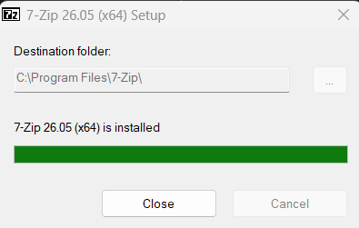

## 2. Installing Oracle VirtualBox

Oracle VirtualBox version **7.2.22** was installed on the Windows host.

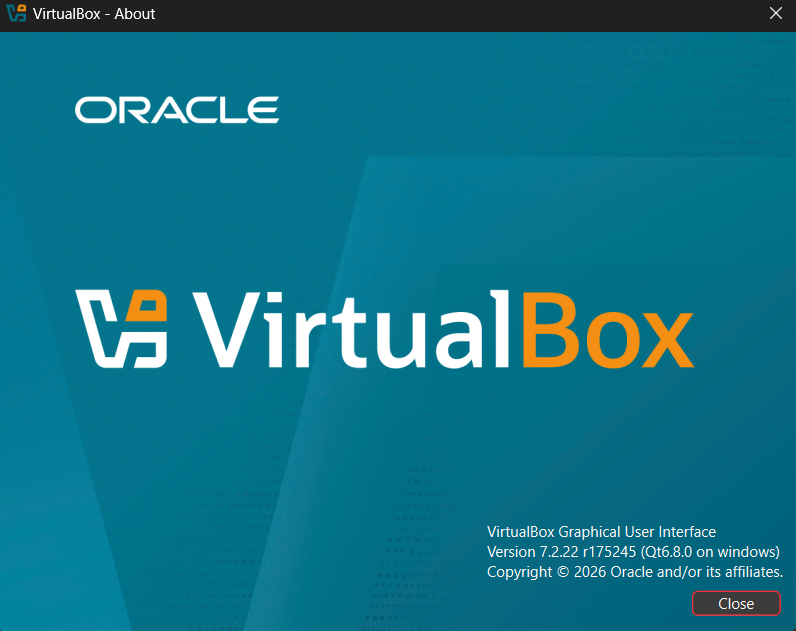

## 3. Configuring the Kali Linux Virtual Machine

A Kali Linux virtual machine named **Fayrouz** was configured in VirtualBox.

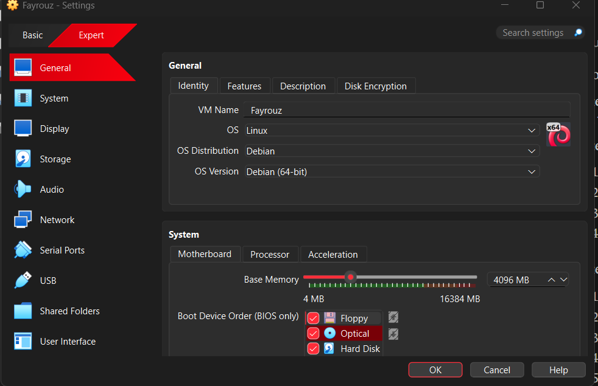

## 4. Starting Kali Linux

The virtual machine was successfully started, and the Kali Linux desktop loaded.

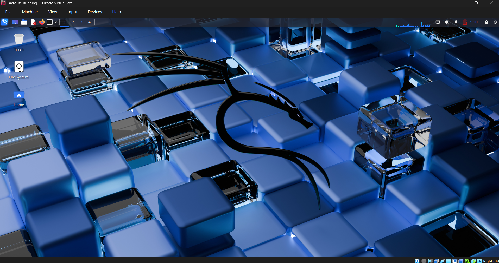

---

# Phase 2 — Network Configuration

## 5. Creating the NAT Network

A VirtualBox NAT Network was configured using the following IPv4 subnet:

`10.0.0.0/24`

NAT Network mode allows virtual machines connected to the same virtual network to communicate while providing a route to external networks.

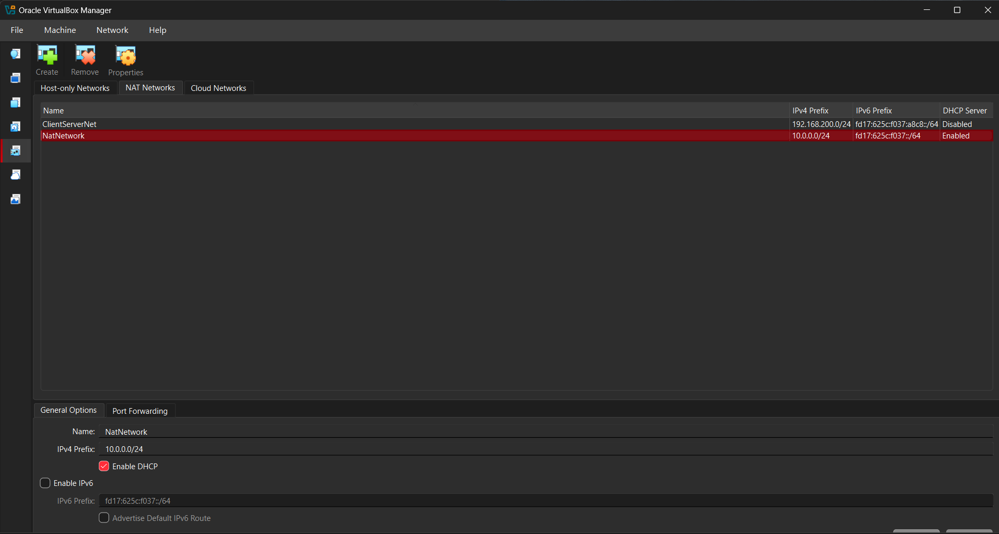

## 6. Configuring the Virtual Network Adapter

The Kali Linux virtual network adapter was attached to the configured NAT Network.

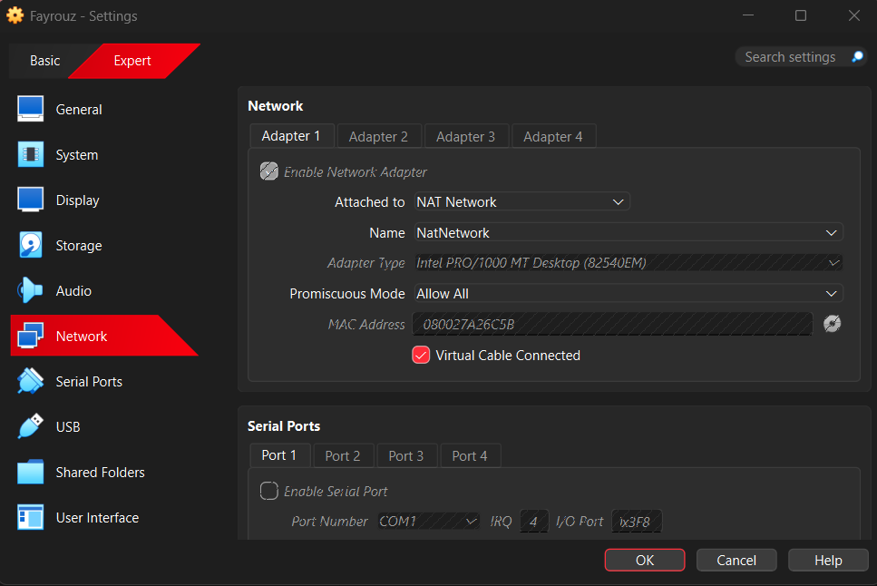

## 7. Assigning a Static IP Address

Kali Linux was configured with these network settings:

| Setting | Value |
|---|---|
| Interface | `eth0` |
| IPv4 address | `10.0.0.2` |
| Subnet mask | `/24` |
| Default gateway | `10.0.0.1` |
| DNS server | `8.8.8.8` |

The following commands were used to inspect the configuration:

```bash
ip a
ip route
```

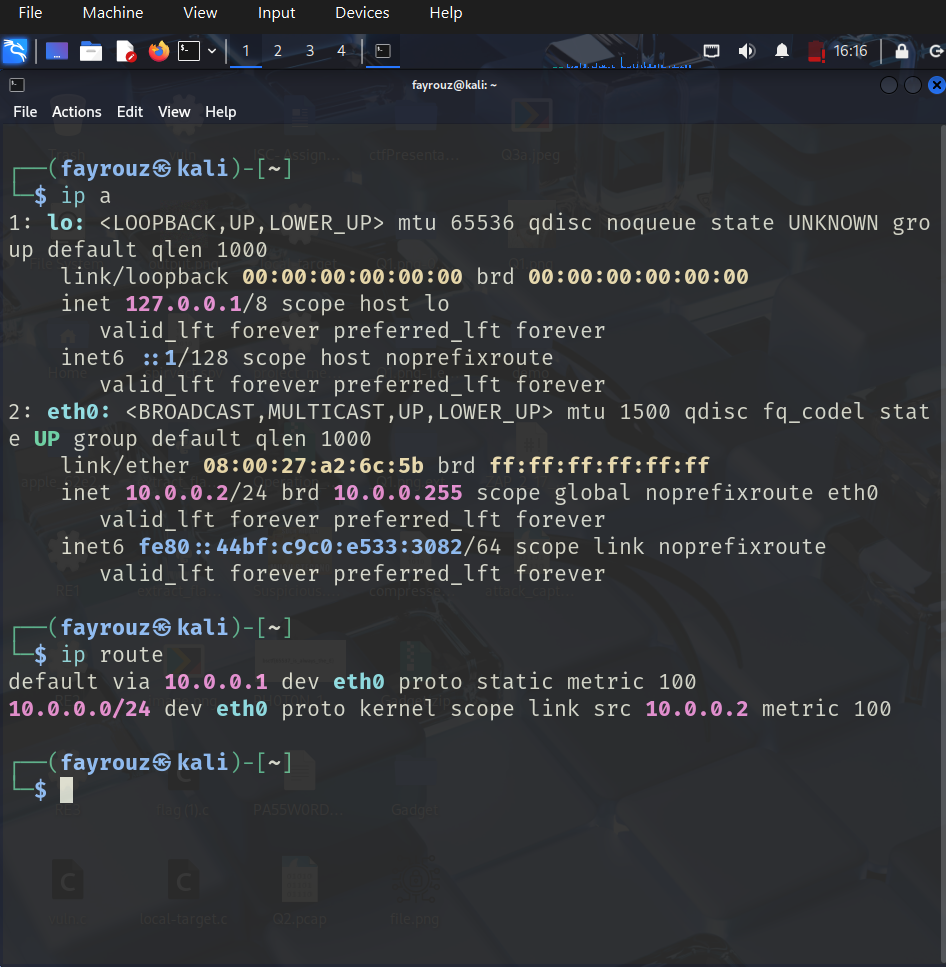

## 8. Testing Gateway Connectivity

The connection between Kali Linux and the virtual gateway was tested using:

```bash
ping -c 3 10.0.0.1
```

The test returned successful replies, confirming gateway connectivity.

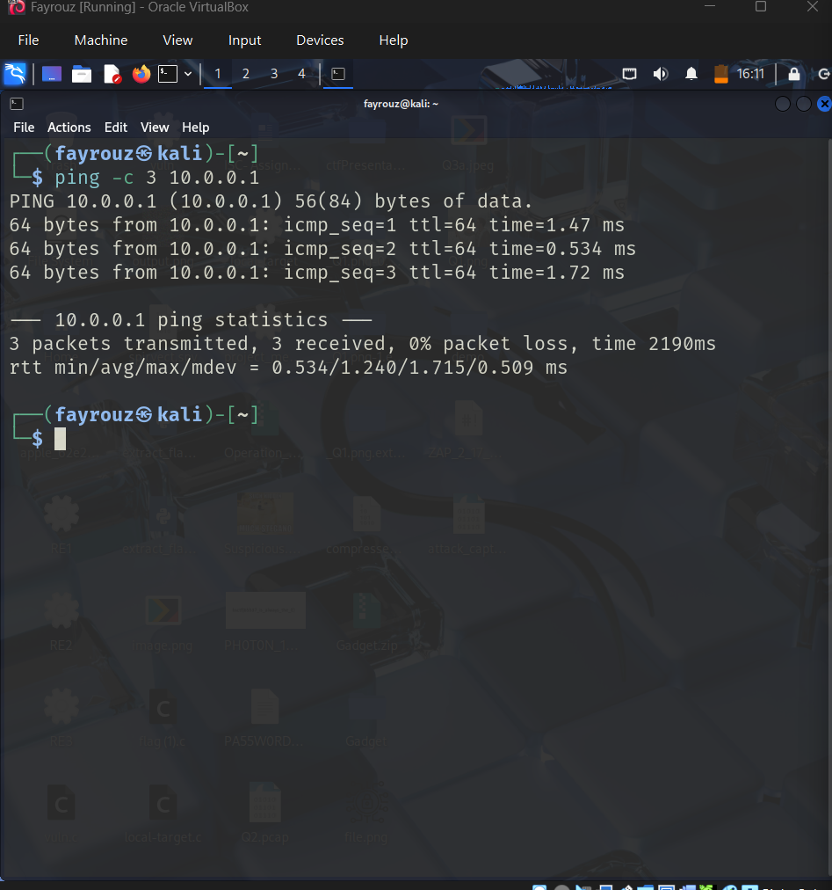

## 9. Testing Internet Connectivity

External network connectivity was tested with:

```bash
ping -c 3 8.8.8.8
ping -c 3 google.com
```

Successful replies confirmed internet access and DNS name resolution.

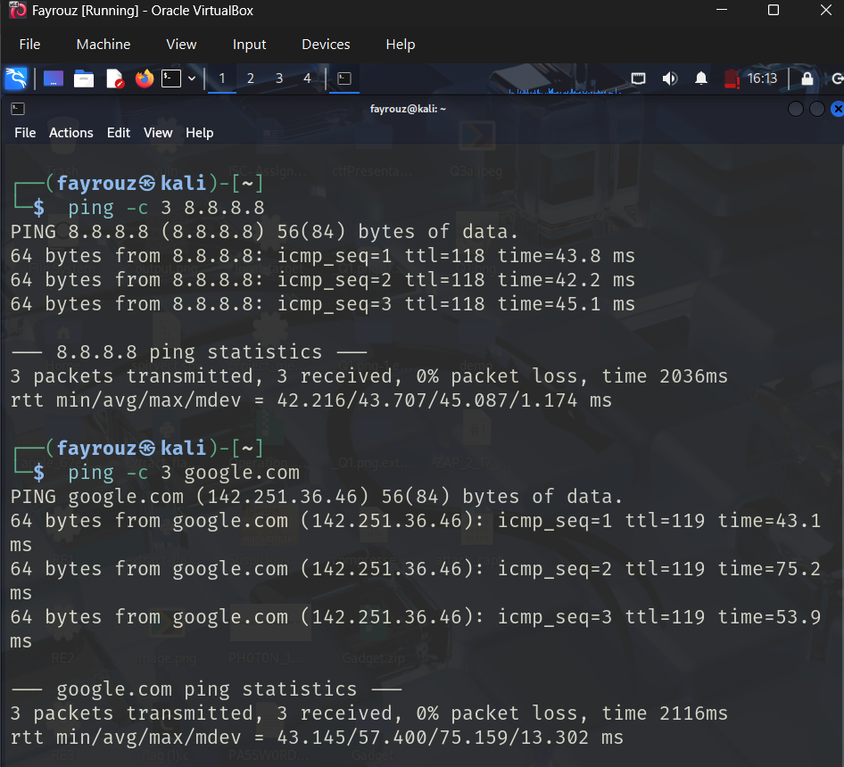

## 10. Final Network Verification

The configured static IP address and internet connectivity were verified together.

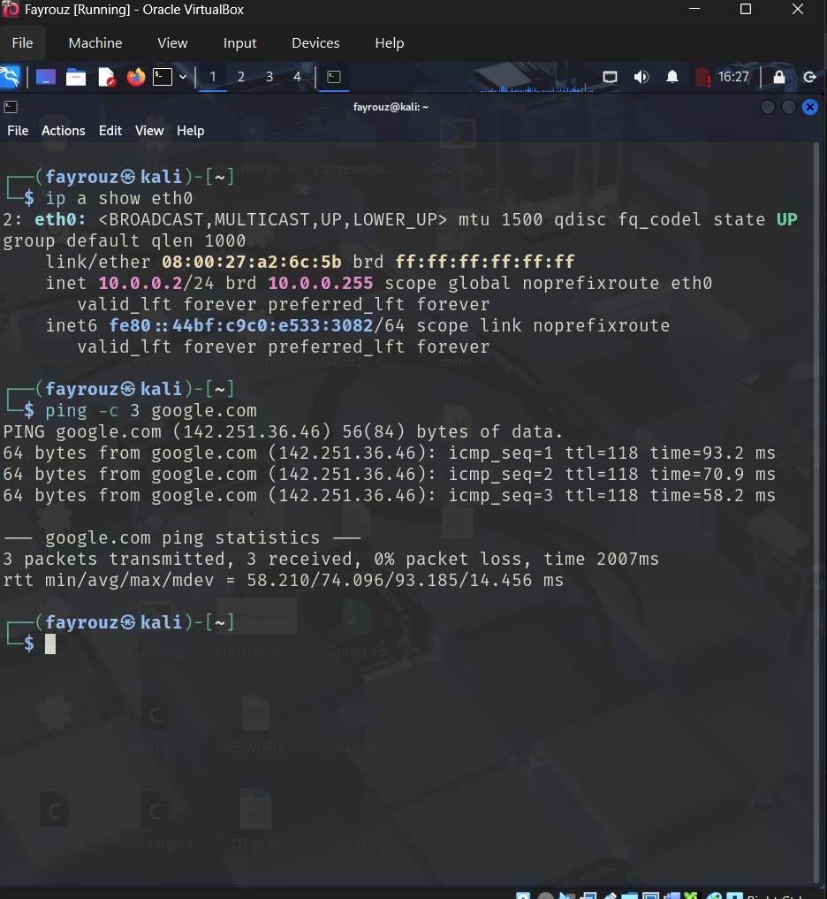

---

# Phase 3 — Virtual Machine Integration

## 11. Enabling Shared Clipboard and Drag-and-Drop

The following VirtualBox settings were enabled:

- **Shared Clipboard:** Bidirectional
- **Drag-and-Drop:** Bidirectional

These settings allow supported content to be transferred between the Windows host and Kali Linux guest.

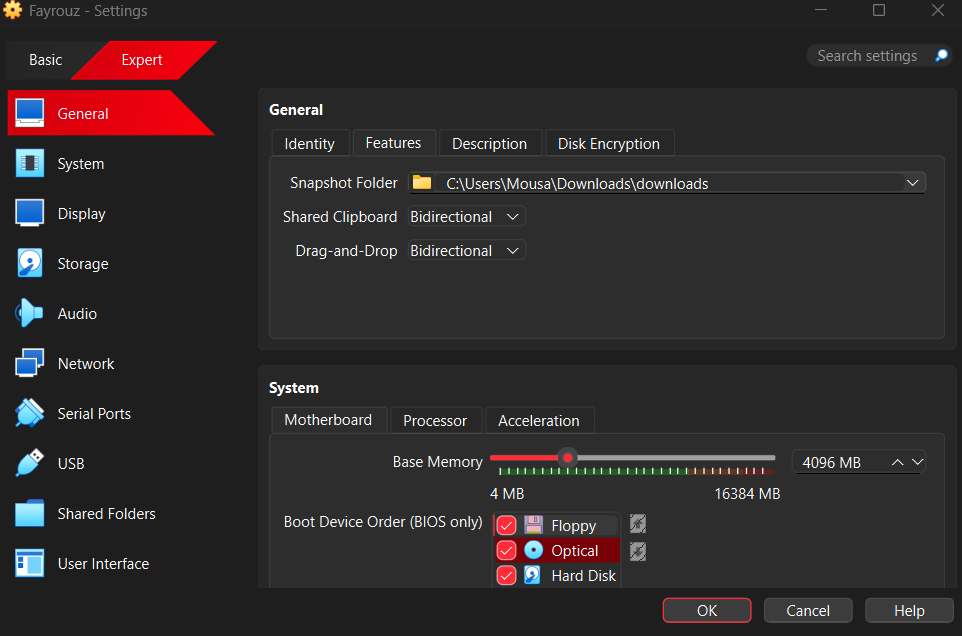

## 12. Configuring a Shared Folder

The Windows Downloads folder was configured as a VirtualBox shared folder.

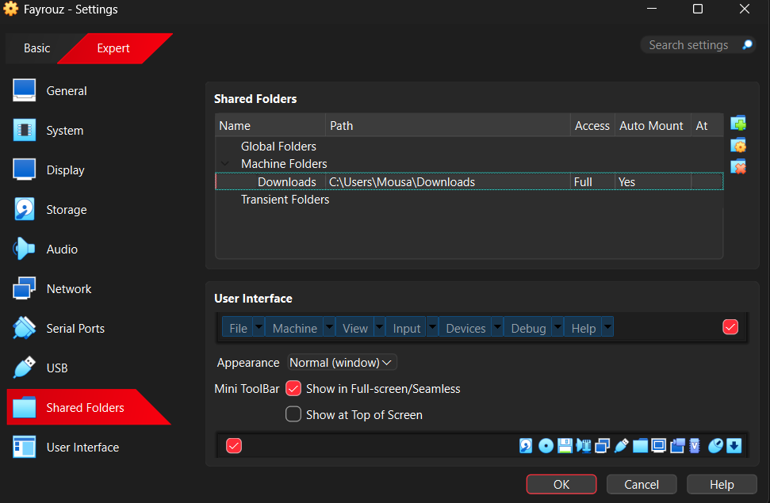

## 13. Configuring Shared Folder Options

The shared folder was configured with automatic mounting and permanent availability.

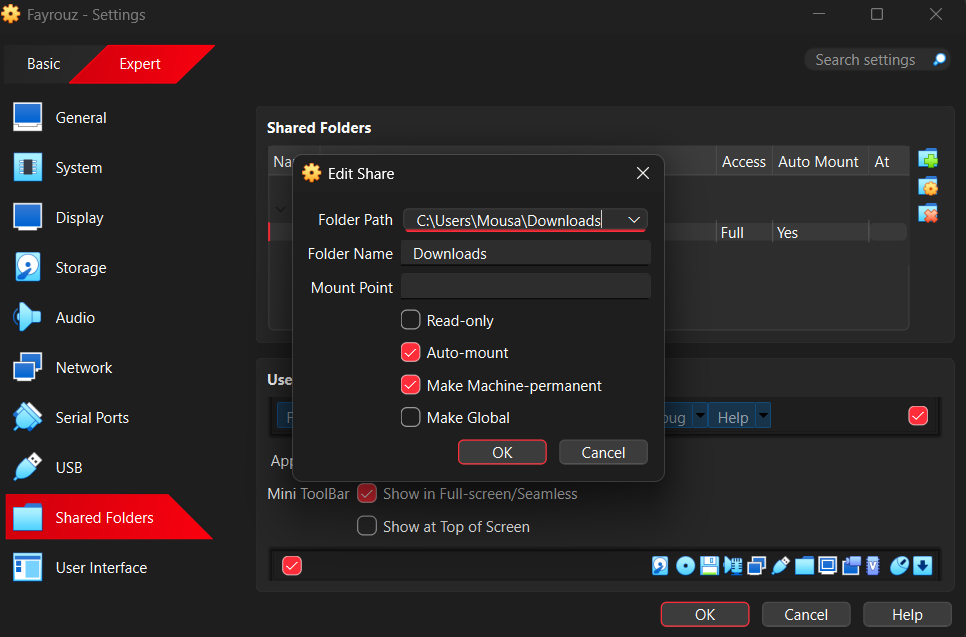

## 14. Testing Clipboard Integration

Clipboard functionality was tested between Kali Linux and Windows.

### Kali Linux to Windows

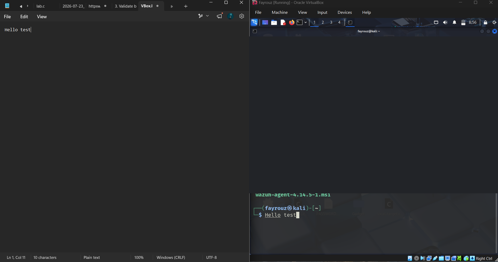

### Windows to Kali Linux

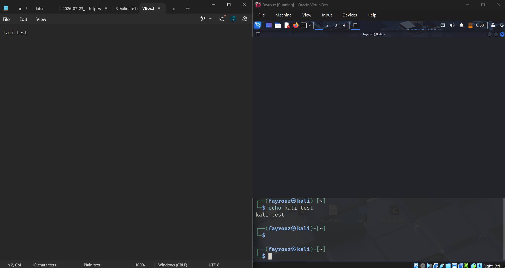

---

# Phase 4 — Verification and Recovery

## Shared Folder Verification

The shared folder was accessed from Kali Linux at:

```bash
/media/sf_Downloads
```

The following command was used to list shared files:

```bash
ls /media/sf_Downloads
```

This verified that Kali Linux could access files from the Windows host.

## Clean System Snapshot

A VirtualBox snapshot named **Clean lab setup** was created.

The snapshot provides a recovery point that can be used to restore the virtual machine to a known state.

---

# Troubleshooting Experience

During the lab setup, network connectivity issues were encountered and investigated.

Troubleshooting included:

- Comparing NAT and NAT Network behavior.
- Inspecting the Kali Linux IP address and routing table.
- Testing gateway and external connectivity using `ping`.
- Checking VirtualBox NAT Network and DHCP configuration.
- Reviewing the Windows-side VirtualBox networking processes.
- Verifying the final network configuration after adjustments.

This process provided practical experience in identifying and diagnosing virtual network connectivity problems.

---

# Project Results

| Requirement | Result |
|---|---|
| 7-Zip installation | ✅ Completed |
| VirtualBox installation | ✅ Completed |
| Kali Linux virtual machine | ✅ Completed |
| NAT Network configuration | ✅ Completed |
| Static IP `10.0.0.2/24` | ✅ Verified |
| Gateway connectivity | ✅ Verified |
| Internet connectivity | ✅ Verified |
| Shared clipboard | ✅ Tested |
| Drag-and-drop configuration | ✅ Enabled |
| Shared folder | ✅ Verified |
| Clean snapshot | ✅ Created |

---

# Skills Developed

- Virtual machine deployment and management
- VirtualBox NAT networking
- Linux IPv4 addressing and routing
- Network connectivity troubleshooting
- Linux command-line operations
- Host–guest file sharing
- Snapshot creation and recovery planning
- Technical documentation using GitHub

---

## Conclusion

This project established a working Kali Linux virtual lab using Oracle VirtualBox.

The completed environment provides a foundation for future cybersecurity exercises involving Linux administration, networking, system analysis, and security testing within an authorized lab environment.

**Project:** Week 1 — VirtualBox and Kali Linux Lab Setup
